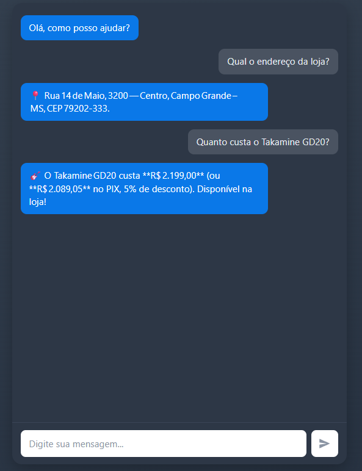

# Empório da Música: agente de atendimento

Protótipo de um agente de atendimento por mensagens de texto para a **Empório da Música**,
loja fictícia de instrumentos musicais em Campo Grande/MS. Feito para o desafio técnico de
AI Engineer.

O agente responde dúvidas sobre produtos, preços, estoque, pedidos e políticas da loja, no tom
definido pelo manual (informal, mas profissional), e recusa com educação o que foge do escopo.



## Sumário

1. [Como rodar](#como-rodar)
2. [Exemplos de conversa](#exemplos-de-conversa)
3. [Arquitetura](#arquitetura)
4. [Decisões técnicas](#decisões-técnicas)
6. [Testes](#testes)
7. [Limitações conhecidas](#limitações-conhecidas)
8. [O que eu faria com mais tempo](#o-que-eu-faria-com-mais-tempo)
9. [Uso de assistentes de código](#uso-de-assistentes-de-código)

## Como rodar

### Requisitos

- Python 3.11
- Uma chave gratuita da API do Groq (https://console.groq.com)
- ~500 MB livres: o modelo de embeddings é baixado na primeira execução

### Instalação

```powershell
git clone https://github.com/luccacorbo/emporio-musica-agent
python -m venv venv
venv\Scripts\Activate.ps1
pip install -r requirements.txt
copy .env.example .env          
```

Edite o `.env` e preencha `GROQ_API_KEY` e `GROQ_MODEL`.

### Executando

```powershell
python -m src.main --api                     # interface web em http://127.0.0.1:8000
python -m src.main                           # conversa no terminal
python -m src.main --salvar examples/x.md    # terminal + grava a conversa em Markdown
python -m src.main --mermaid                 # imprime o diagrama do grafo
python -m src.main -v                        # logs detalhados (rejeições da validação, etc.)
```

> A primeira execução baixa o modelo de embeddings e demora mais. As seguintes são rápidas.

## Exemplos de conversa

As conversas estão em [`examples/`](docs/examples/), geradas pelo próprio agente com `--salvar`.

| Arquivo | Cenário | O que demonstra |
|---|---|---|
| [`01_catalogo.md`](docs/examples/01_catalogo.md) | Violões até R$ 1.000 | consulta ao catálogo com filtro de preço |
| [`02_preco.md`](docs/examples/02_preco.md) | Preço do Takamine GD20 | preço, promoção e desconto PIX |
| [`03_devolucao.md`](docs/examples/03_devolucao.md) | "Me arrependi da compra" | aplicação da política de arrependimento (não trivial) |
| [`04_fora_do_escopo.md`](docs/examples/04_fora_do_escopo.md)| assunto externo | escopo da loja e recusa educada |
## Arquitetura

Visão geral: o cliente fala com a interface web (ou o terminal), que chama um **grafo LangGraph**.
O grafo decide o caminho, o LLM chama **ferramentas** (catálogo, pedidos, políticas) e uma
**validação de saída** confere a resposta antes de entregá-la.

Os diagramas completos estão em [`ARCHITECTURE.md`](docs/ARCHITECTURE.md).

```
src/
├── data/          carga dos CSVs e repositories (pandas + Pydantic)
├── models/        modelos de catálogo, clientes e pedidos
├── rag/           chunking e tipos do RAG (sem framework)
├── tools/         ferramentas do agente (sem framework)
├── validation/    guardrails de entrada, de ferramentas e de saída
├── agent/         cliente do LLM, prompts, rotas
├── integrations/  ÚNICO lugar com LangChain, LangGraph, Chroma e HuggingFace
├── api/           FastAPI
└── main.py        CLI e raiz de composição (injeção de dependências)
frontend/          HTML, CSS e JS puros
```

Fluxo de um turno:

1. **Guardrail de entrada** (regex, sem LLM): bloqueia mensagem vazia, longa, prompt injection e pedido de dados de terceiros.
2. **Classificador** (LLM): escolhe a rota `da_loja`, `reclamacao`, `social` ou `fora_do_escopo`.
3. **Agente com ferramentas** (rota `da_loja`): o LLM chama `buscar_produto`, `consultar_disponibilidade`, `consultar_pedido` e `buscar_politica`. As demais rotas respondem direto, sem ferramentas.
4. **Validação de saída** (determinística): confere a resposta contra o que as ferramentas devolveram. Se reprovar, o agente tenta uma vez de novo. Se reprovar de novo, entrega uma mensagem segura.

## Decisões técnicas

### Abordagem do agente: híbrido (function calling + RAG + roteamento em grafo)

Dados estruturados (preço, estoque, pedido) e texto de políticas pedem estratégias diferentes:

- **Políticas → RAG.** O manual é texto estruturado em seções; busca semântica com recuperação por seção responde "posso devolver?" sem depender de palavras-chave exatas.
- **LangGraph** para o fluxo: o roteamento, o laço agente <-> ferramentas e o retry da validação são um grafo de estados. Fica explícito, testável e desenhável (`--mermaid`).
- **Por que não um agente SQL?** Os dados são pequenos (65 produtos, 20 pedidos) e há regras de negócio (promoção ativa, PIX não cumulativo) que ficam mais seguras em código do que em SQL gerado pelo modelo.

### Modelo e provedor: Groq + openai/gpt-oss-20b

- Camada gratuita, o que permite ao avaliador rodar sem custo.
- Suporta function calling e responde rápido.
- O acesso ao LLM está atrás de um contrato (`LLMClient`), reaproveitado de outro projeto.


### Arquitetura RAG

- **Extração:** `PyPDFLoader` em modo `layout`.
- **Chunking por seção** (28 chunks): o manual é estruturado, então cada chunk começa com o caminho da seção (`4. Trocas > 4.1 Arrependimento`), nunca atravessa páginas e seções longas são divididas (máx. 900 caracteres, overlap de 100).
- **Embeddings:** `multilingual-e5-small`, local (sem chave, sem custo), com os prefixos `query:` e `passage:` que o modelo exige.
- **Índice:** Chroma em memória com distância de cosseno, reconstruído a cada execução (28 chunks levam segundos e evitam índice desatualizado).
- **Sem limiar de score:** os scores do E5 são comprimidos (~0,77 a 0,90) e não separam bem "relevante" de "ruído". O escopo é decidido pelo roteamento, não pelo retriever. Em 12 perguntas de teste, a seção correta ficou entre os 4 primeiros resultados em todas.

### Estratégia de prompt

- **Persona** no `system prompt`: informal, acolhedora, respostas curtas no estilo WhatsApp, no máximo dois emojis.
- **Regras numeradas** extraídas do manual.
- **Contexto temporal** injetado a cada turno (data, hora de Campo Grande e se a equipe humana está em expediente), para informar o horário de retorno fora do expediente.
- **Prompts por rota:** saudação, reclamação e fora do escopo têm instruções próprias e respondem sem ferramentas.
- **Retry com correção:** quando a validação reprova, os motivos entram no `system prompt` da nova tentativa, sem poluir o histórico.

### Validação e anti-alucinação (três camadas)

1. **Entrada** (`input_guardrails`): determinística. Não decide escopo por palavra-chave (para não bloquear "vocês vendem cabos?", que é pergunta da loja).
2. **Ferramentas** (`tool_validation`): argumentos validados por schema Pydantic e, para pedidos, **número e e-mail precisam ter sido ditos pelo cliente na conversa** (LGPD). O modelo não consegue chutar um e-mail.
3. **Saída** (`output_validation`): a resposta só pode afirmar valores, prazos, parcelas, status, código de rastreio, disponibilidade e regras da loja que existam nos resultados das ferramentas. Também não pode expor instruções internas nem citar o manual (documento de uso restrito).

A validação é por regex e não por um segundo LLM: é gratuita, previsível e testável.

### Interface: API FastAPI + front em HTML/CSS/JS puros

O enunciado diz que o foco é o agente, então a interface é simples: um endpoint `POST /api/chat`
e uma página sem build (sem Node). O `conversa_id` vem do navegador e reaproveita o histórico em memória do agente.

### Persistência do histórico

Em memória, por `conversa_id`. Basta para a experiência de uma sessão e evita infraestrutura
extra. Veja as [`limitações abaixo`](#limitações-conhecidas).

### Isolamento de frameworks

Só `src/integrations/` importa LangChain, LangGraph, Chroma e HuggingFace. O resto usa tipos
próprios (Pydantic). Isso é **verificado por teste** (`tests/test_architecture.py`), o que
mantém o domínio testável sem frameworks e facilita trocar peças.


## Testes

```powershell
pytest -m "not embeddings"                                  # rápido, sem baixar modelo
pytest tests/retrieval/test_retriever.py -m embeddings -v   # usa o modelo real de embeddings
```

Cobrem dados,
ferramentas, guardrails, validação de saída, chunking, API, CLI e a regra de arquitetura.


## Limitações conhecidas

- **Latência cresce em conversas longas.** O histórico guarda as chamadas e os resultados JSON das ferramentas, e cada chamada ao LLM reenvia tudo. Como um turno chama o LLM de 2 a 4 vezes (classificar, agente, agente após ferramenta, retry), os tokens de entrada aumentam a cada rodada. No plano gratuito do Groq isso também aumenta a chance de rate limit (429) e de retries.
  - *Correção com mais tempo:* guardar no histórico só as falas do cliente e as respostas finais, limitar a janela às últimas 10 a 12 falas e deixar o agente reconsultar as ferramentas quando precisar (a validação usa o histórico como evidência).
- **Validação de saída por palavras-chave e números.** Não pega toda alucinação: "o frete de devolução é por conta do cliente" passa se o manual foi consultado, porque o regex não compara o sentido.
- **Histórico em memória.** Reiniciar o servidor apaga as conversas.
- **Índice reconstruído a cada execução.** Aceitável com 28 chunks; com um manual maior seria preciso persistir.
- **Sem integração real** de reclamações, sem calendário de feriados e sem identificação do cliente além de pedido + e-mail.

## O que eu faria com mais tempo

- Corrigir a latência (poda do histórico) e medir antes e depois.
- Busca de produtos mais tolerante (fuzzy ou embeddings no catálogo) e tratamento de sinônimos.
- Avaliação sistemática: conjunto de perguntas com respostas esperadas, rodando em CI, para medir acerto, alucinação e rejeições indevidas.
- Integração com sistema de tickets para reclamações, calendário de feriados e atendimento humano de fato (transferência).
- Observabilidade: logs estruturados, métricas de latência e de custo por turno.
- Autenticação do cliente mais robusta antes de expor dados de pedido.

## Uso de assistentes de código

**Ferramenta:** Claude

**Como usei:** trabalhei por etapas, utilizando a ferramenta como pair programming, gerando o codigo **e testes** de cada camada definida antes do desenvolvimento, validando antes de seguir:

1. Camada de dados (loader, repositories, modelos) com testes.
2. RAG: extração do PDF, chunking por seção, embeddings e retriever, **inspecionando a recuperação antes de conectar o LLM**.
3. Ferramentas, guardrails e validação de saída.
4. Prompts, cliente do LLM e grafo LangGraph.
5. CLI com injeção de dependências, API FastAPI, interface web e diagramas.

**Onde eu intervim:**
- Defini estrutura do repositorio e regras a serem seguidas pelo modelo da antrophic
- Defini a regra de isolar os frameworks em `integrations/` e a verifiquei com teste de arquitetura.
- Decidi **não** usar limiar de score no retriever e tratar o escopo por roteamento.
- Identifiquei problemas rodando o sistema: a citação da fonte do manual aparecendo na resposta ao cliente (corrigida mantendo a validação interna) e a lentidão em conversas longas (documentada como melhoria).
- Rodei os testes e corrigi o que falhou (por exemplo, o teste de arquitetura que reprovou a API importando o grafo, resolvido com um `Protocol`).
